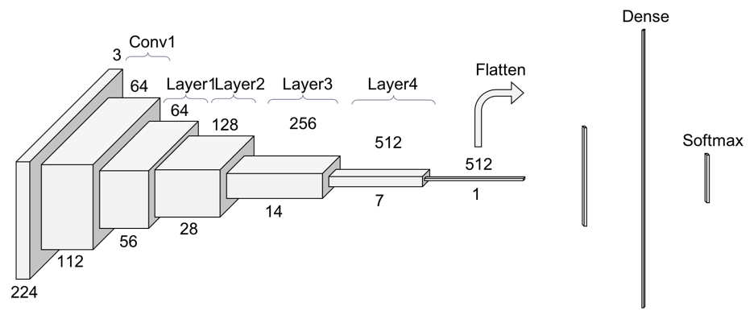
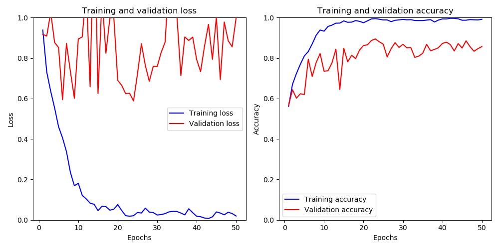

# Foot Fracture & Edema Classification from Ankle MRI

Deep-learning models that classify sagittal ankle MRI slices as **fracture (+ edema)**, **edema without fracture**, or **healthy**, with the goal of narrowing the region a radiologist must review and speeding up diagnosis.

**Presenter:** Om Dange · **Mentor:** Dr. Jacob Furst

📊 **Presentation:** [docs/foot-fracture-mri-presentation.pptx](docs/foot-fracture-mri-presentation.pptx)

> The MRI images and physician annotations are clinical data and are **not** included in this repository. See [docs/DATA.md](docs/DATA.md).

---

## Highlights

- Built an end-to-end pipeline: Label Studio annotations → cleaned label tables → slice filtering → patient-level train/validation split → CNN training and evaluation.
- Compared two formulations on a pretrained **ResNet-18** (ImageNet weights, 224×224 input, 80/20 split):
  - **3-way classifier:** Fracture / Edema / Healthy in one model.
  - **Sequential (2-step) classifier:** Healthy vs. Unhealthy, then Fracture vs. Edema on the unhealthy slices, with the second model transfer-learned from the first (early layers frozen, final layers fine-tuned).
- **Best result:** 3-way ResNet-18 with rotation augmentation reached **89.0% accuracy** with **87–90% sensitivity for every class**.

## Problem

Ankle fractures nearly always come with surrounding bone-marrow edema, and edema can also appear without a fracture. Separating the two on MRI takes time. The question was:

> Given a curated set of MRI slices, can a CNN reach clinically relevant accuracy and sensitivity in detecting fracture and edema?

## Data (summary)

Sagittal ankle MRI slices (SAGT1 and SAGIR sequences), each labeled by a physician with bounding boxes for fracture and/or edema.

| Class | Slices (SAGT1) |
|---|---|
| Edema | 715 |
| Fracture | 301 |
| Healthy (informative slices) | 439 (of 1,636 before filtering) |

**Preprocessing**
- **Black-slice removal:** a pixel ≤ 10 counts as black; slices with ≥ 65% black pixels are dropped ([del_black_img.py](footfracture/preprocessing/del_black_img.py)).
- **Intensity normalization:** zero mean and unit variance per channel.
- **Patient-level split:** consecutive slices of one patient look almost identical, so whole patients are assigned to either train or validation to avoid leakage ([separate_patients.py](footfracture/preprocessing/separate_patients.py)).
- **Augmentation (one experiment):** 90°, 180° and 270° rotations.

## Model

ResNet-18 pretrained on ImageNet (`IMAGENET1K_V1`). The first convolution is replaced to accept single-channel (grayscale) MRI slices, and the classification head is replaced for 2 or 3 classes. The models are trained with cross-entropy loss and Adam (lr = 0.001) for 50 epochs.



## Results

All results are on the held-out validation patients (SAGIR images, 80/20 split). Sensitivity is one-vs-rest recall per class, computed from the confusion matrices below.

### 3-way classifier with rotation augmentation (best)

| | Fracture | Edema | Healthy |
|---|---|---|---|
| Sensitivity | 0.871 | 0.900 | 0.903 |
| Specificity | 0.946 | 0.898 | 0.983 |

**Overall accuracy: 0.890** (1,093 / 1,228)

| True ↓ / Predicted → | Fracture (+Edema) | Edema (no fracture) | Healthy |
|---|---|---|---|
| **Fracture (+Edema)** | 390 | 56 | 2 |
| **Edema (no fracture)** | 33 | 425 | 14 |
| **Healthy** | 9 | 21 | 278 |



### Sequential (2-step) classifier

| Step | Task | Accuracy | Confusion matrix (true class: correct / wrong) |
|---|---|---|---|
| 1 | Healthy vs. Unhealthy | 0.930 | Healthy: 56 / 10 · Unhealthy: 144 / 5 |
| 2 | Fracture vs. Edema | 0.893 | Fracture: 34 / 3 · Edema: 41 / 6 |
| 1 → 2 | End-to-end, 3 classes | **0.756** | see below |

Each step is accurate on its own, but errors compound when the steps are chained: 59 of 154 fracture slices end up labelled edema-only. The single 3-way model performed better end to end.

| True ↓ / Predicted → | Fracture (+Edema) | Edema (no fracture) | Healthy |
|---|---|---|---|
| **Fracture (+Edema)** | 90 | 59 | 5 |
| **Edema (no fracture)** | 10 | 97 | 6 |
| **Healthy** | 3 | 24 | 144 |

### 3-way classifier without augmentation

| True ↓ / Predicted → | Fracture (+Edema) | Edema (no fracture) | Healthy |
|---|---|---|---|
| **Fracture (+Edema)** | 88 | 23 | 1 |
| **Edema (no fracture)** | 10 | 104 | 4 |
| **Healthy** | 2 | 5 | 70 |

More training curves are in [docs/figures/](docs/figures/).

## Limitations and next steps

- **Small dataset:** roughly 120 patients, and the classes are imbalanced (fracture is the smallest).
- **Augmented validation set:** in the augmented run, rotated copies are also in the validation set, so its numbers are not directly comparable to the unaugmented run.
- **Noisy validation loss:** the validation-loss curves suggest overfitting. Planned next steps are regularization, early stopping, and k-fold cross-validation over patients.
- **Slice-level only:** predictions are per slice. Combining slices to make one prediction per patient, and using the bounding boxes for localization, are natural extensions.

## Repository structure

```
footfracture/
├── config.py            # data/results paths (set via environment variables)
├── metrics.py           # sensitivity / specificity / accuracy helpers
├── exploration/         # dataset inventory: sequences per patient, image sizes
├── annotations/         # Label Studio JSON → CSV, bounding-box rendering and cropping
├── preprocessing/       # black-slice filtering, resizing, patient-level split, rebalancing
└── models/
    ├── three_way_classifier.py                   # Fracture / Edema / Healthy (pretrained ResNet-18)
    ├── sequential_transfer_resnet18.py           # sequential: Healthy/Unhealthy → Fracture/Edema via transfer learning
    ├── sequential_step1_healthy_vs_unhealthy.py  # step 1 alone (ResNet-18 implemented from scratch)
    ├── sequential_step2_fracture_vs_edema.py     # step 2 alone (small-CNN baseline)
    ├── three_way_resnet_imagefolder.py           # ImageFolder-based ResNet-18 variant
    └── baseline_cnn.py                           # early small-CNN baseline
docs/
├── foot-fracture-mri-presentation.pptx
├── DATA.md
└── figures/
```

## Running

The code is a research snapshot. It has been reorganized and its paths made configurable, but it has not been re-run since the reorganization because the data cannot be published.

```bash
pip install -r requirements.txt
export FOOT_FRACTURE_DATA_DIR=/path/to/your/data   # default: ./data
python -m footfracture.models.three_way_classifier
```

Run scripts as modules (`python -m footfracture....`) from the repository root. Outputs such as plots and confusion-matrix CSVs are written to `results/`.

## Acknowledgements

Thanks to Dr. Jacob Furst for mentorship, to the physicians who annotated the MRI studies, and to the teammates who contributed preprocessing scripts and experiments.
